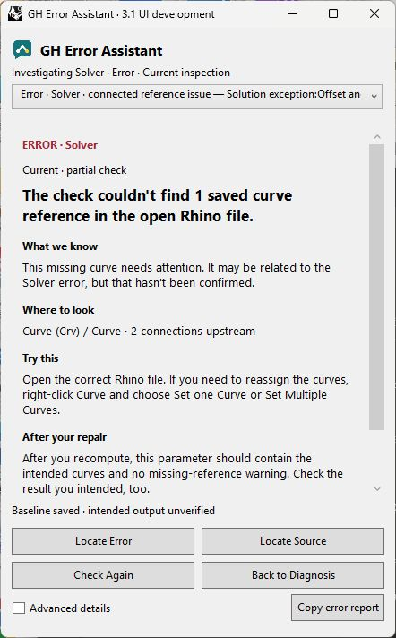

# GH Error Assistant 3.1 RC1

Offline troubleshooting for Windows / Rhino 9 / Grasshopper 1. No other host/platform support is advertised.

Select a warning, open Error Assistant from the Grasshopper menu or Error Help launcher, and choose Investigate. Locate Error frames the reporter; Locate Source frames the selected possible upstream source. A connection does not establish causality. Repair manually, recompute, and use Check Again. Back displays explicitly historical findings. Advanced details and Copy preserve original messages. No telemetry, uploads, AI services or automatic repairs.

## Installation and rollback
Close Rhino. Preserve your current GHA outside discovery. Extract the Windows ZIP, unblock through Properties if required, and copy only GHErrorAssistant.gha into the Components Folder opened by Grasshopper File > Special Folders. Restart Rhino. Do not combine Yak and manual copies. For manual uninstall, close Rhino and remove only that GHA; restore your verified backup. For Yak use PackageManager uninstall first.

## Evidence and limitations
The implementation passed native Number/Curve repair, navigation and a measured 302-second session. Actual 125% / 120 DPI was measured. Complete minimum-size 125%, 150%, 200% and full dark appearance remain unverified. This new RC changes caption, version and support metadata and requires a targeted native smoke test before publication. Warning disappearance is not proof of intended output.

## License and support
MIT covers project code and original branding. Rhino and Grasshopper are registered trademarks of Robert McNeel & Associates; contextual host UI is not relicensed under MIT. This plugin is not endorsed by McNeel. Rhino is separately licensed. No vendor DLLs are bundled.
Proposed support, not live until authorized creation: https://github.com/mohamadshenar/GH-Error-Assistant-Public/issues .

## Build
Use Windows and global.json SDK. Run dotnet restore GHErrorAssistant.sln -p:RhinoSdkPath=, then dotnet build GHErrorAssistant.sln -c Release -p:RhinoSdkPath= -p:SourceRevisionId=17dc55a45270b0c25ec197b1d66da291f20a98fa and dotnet test GHErrorAssistant.sln -c Release --no-build. Repeatable recipe only; no bit-for-bit reproducibility claim.

Screenshot is the accepted implementation build, not renewed native acceptance of this RC.
