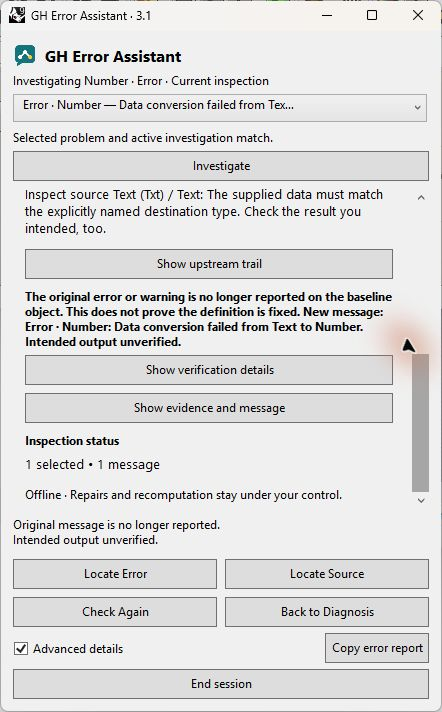

# GH Error Assistant 3.1.0

Offline troubleshooting for Grasshopper 1. Understand warnings, inspect connected upstream evidence, and navigate to the objects worth checking. A connected candidate is a possible source, not a proven cause.

**Supported scope:** Windows, Rhino 9 with its default .NET 10 runtime, Grasshopper 1. Rhino 8, Grasshopper 2, macOS, Rhino.Inside and alternate runtimes are not qualified.

This stable distribution is prepared for publication. The existing public release is 3.1.0-rc.1 until a separately approved 3.1.0 publication completes. Do not substitute an RC1 download when verifying a 3.1.0 checksum.

## Install or upgrade

Once 3.1.0 is listed, run **PackageManager** in Rhino 9, search **gh-error-assistant**, select **3.1.0**, install and restart Rhino. Stable versions do not require **Include pre-releases**; RC1 does. If only RC1 appears, stable publication has not completed or the host is not compatible.

Use one installation method. Preserve the previous package or GHA and its checksum outside plugin discovery before upgrading. Do not combine a manual copy with a Yak installation. See [installation and rollback](INSTALLATION.md).

The GitHub Windows ZIP is an alternative manual installation. Verify SHA256SUMS.txt, close Rhino, extract it, and copy only GHErrorAssistant.gha into the Components Folder opened by Grasshopper **File → Special Folders → Components Folder**. Never overwrite a loaded assembly or remove unrelated plugins.

## Use

1. Open Grasshopper and **Error Assistant → Open assistant**, or use the Error Help launcher in Params → Util.
2. Select the reporting object, choose its warning/error and click **Investigate**.
3. Read the observation and manual repair. **Locate Error** frames the reporter; **Locate Source** frames the selected possible upstream source.
4. Repair the definition yourself and deliberately recompute. **Check Again** refreshes the inspection; **Back to Diagnosis** retains navigation and explicitly historical findings.
5. Check the intended output independently. A disappearing warning does not prove that result is correct.

Advanced details retain evidence, alternatives, limits and original messages. Copy reports may contain definition names and object IDs: review them before sharing.

## Evidence and limitations

The exact native-tested 3.1.0 GHA passed bounded Rhino 9/.NET 10 testing of missing data, two connected upstream branches, navigation, API-driven arithmetic repair with independent output 4, replacement errors, normal window lifecycle and fresh startup. The assistant did not independently certify intended output. Supported fingerprints showed only intended Locate selection/view changes; coverage was incomplete and supplemented for the slider.

150%/200% DPI, full dark appearance, pristine clean-profile installation and complete exception-log coverage remain unverified. Earlier 125% evidence does not establish every minimum-size state. No universal crash-free, leak-free, root-cause or repair guarantee is made. See [limitations](docs/release/LIMITATIONS.md).

## Privacy, support and license

No telemetry, AI services or diagnostic uploads. Repairs, recomputation and saving remain under your control; Locate intentionally changes selection/view. See [privacy](PRIVACY.md).

Support: [GitHub issues](https://github.com/mohamadshenar/GH-Error-Assistant-Public/issues). Include versions and reproduction steps with private data removed. MIT covers project contributions and original branding; Rhino is separately licensed. No vendor DLLs are bundled. See [notices](THIRD-PARTY-NOTICES.md). This project is not endorsed by McNeel.

See [repeatable builds](BUILDING.md). Building is not a promise of byte-identical reproduction or native acceptance of the result.
